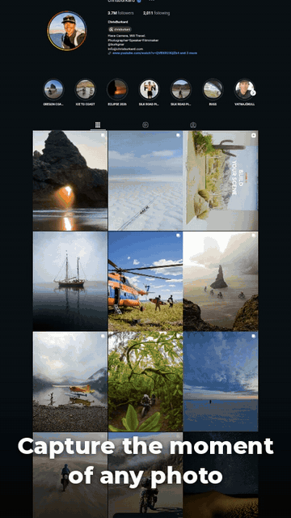
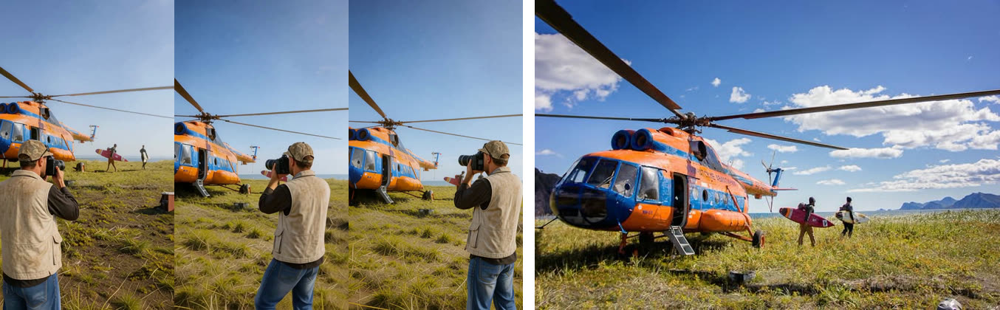
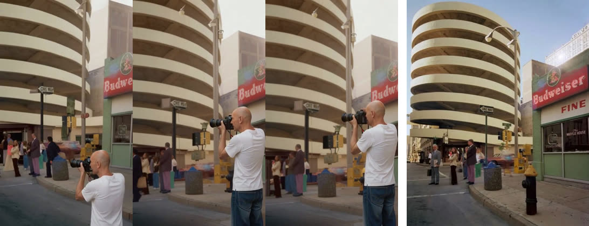
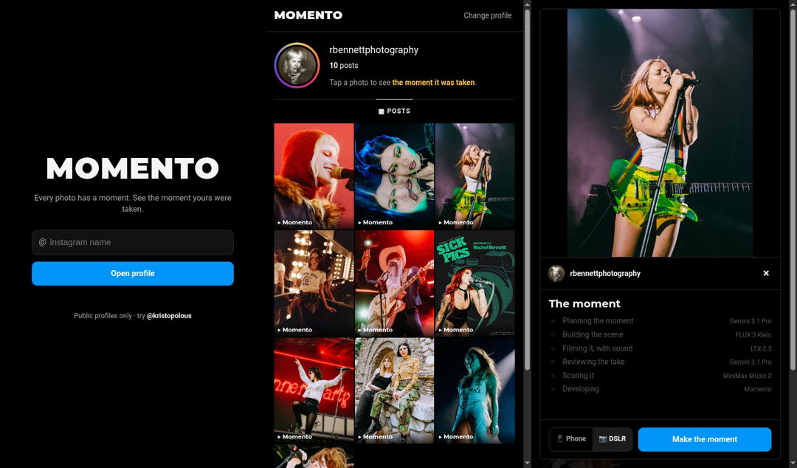

# Momento

**Type an Instagram name. Tap a post. Watch the moment the photo was taken.**

Live: **https://9ol.es/momento-demo/** · Demo video: **https://9ol.es/momento-video**



Momento opens a public Instagram profile and shows its most recent posts as a grid. Tap one and it films the moment
that photo was taken, from a bystander's point of view. The person in the profile picture stands where the camera
stood, phone or camera raised. The subject moves into the exact instant the photo froze, the shutter fires, and the
video cuts to the real post.

Built for Comfy's **Open Source Higgsfield** build night, entirely in ComfyUI: FLUX 3, MiniMax H3, LTX-2.5, Depth
Anything 3 and Gemini or a local vision model. It runs on Comfy Cloud or on your own GPU, with open weights only.

## What it makes

Each strip shows three frames of the generated moment, then the real post.






## How it works: geometry, not prompts

Where the photographer stands, and which way they face, isn't left to a prompt. It's computed from the post itself.


1. **Plan.** A vision LLM looks at the profile picture and the post and describes the scene, the action, the
   photographer and the place's sound. This is Gemini 3.1 Pro on Comfy Cloud, or any Ollama-API vision model locally.
2. **Character sheet.** FLUX 3 draws the account owner as a turnaround (front, side, back, camera raised), so they
   stay the same person from every angle. If the profile picture isn't a person, it draws an anonymous person.
3. **The place in 3D.** Depth Anything 3 (metric) rebuilds the post as a mesh. The post's camera is where the
   photographer stood. `RenderMesh` renders the view of a bystander standing behind them, and FLUX 3 fills the gaps.
4. **Placement.** FLUX 3 puts the person from the sheet into that view. Its layout boxes are projected from their
   real 3D position, so they face the subject with the phone or camera aimed at it.
5. **Film it.** MiniMax H3 films the seconds before the instant, ending on that frame, and the subject moves into the
   photo's pose. Camera moves (dolly in, orbit, crane down) start from a second camera position in the same 3D scene.
   H3's `overall_soundscape` prompt structure gives real ambient sound and a shutter click, with no generated speech.
6. **Review.** The LLM watches every take and only the best one is kept. Close-ups (a laptop on a desk) have no
   useful depth, so they're routed through FLUX 3 outpainting instead.
7. **The reverse shot.** The film cuts around to face the photographer as they take the picture, then the shutter
   fires and it cuts to the real post. The reverse shot is built from the push-in's own photographer, so the clothes,
   the camera and the way it's held carry across the cut. Only the face comes from the profile picture.

## The sponsors' models, feature by feature

Momento is a showcase of what FLUX 3, LTX-2.5 and current ComfyUI can do together. Below is every feature it uses,
what the feature is for, and where it is in the code.

### FLUX 3 (Black Forest Labs)

FLUX 3 makes every still that the video models film between: the character sheet, the filled-in 3D view, and the
photographer placed in the scene. Momento uses both forms of it.

- **FLUX 3 Klein, open weights, on your own GPU.** The int8 `flux3-image-klein-int8-convrot` checkpoint with its
  Qwen3-VL 4B text encoder and the FLUX.2 VAE. It runs in 16 steps at CFG 1, so a 24 GB card can afford several
  candidates per take (`scripts/local.py`, `klein()`).
- **FLUX 3 Image, through Comfy's BFL partner node** (`Flux3ImageNode`), for the Comfy Cloud pipeline
  (`scripts/moment.py`, `scripts/cloud.py`). There's no local model at all, just a node in the graph.
- **Multi-reference editing.** Klein takes several reference images through ComfyUI's `ReferenceMultiLatent`, and
  the prompt cites them as `ref_image_0`, `ref_image_1`, and so on. Momento passes the scene as one reference and
  the person as another, so the prompt reads like a direction: "add the person from ref_image_1 into ref_image_0 as
  the photographer, change nothing else". The partner node does the same with `image_1`, `image_2`.
- **Layout boxes.** FLUX 3 accepts a layout: a JSON table of regions, each with an id, a target box on a 0–1000
  grid, a description and optionally a source box in a reference image. In Momento those boxes aren't guessed:
  they're the photographer's head, body and phone, projected from their real 3D position in the rebuilt place
  (`scripts/geo.py`, `layout()`). So FLUX 3 is told exactly where in the frame a person standing there would appear,
  and which way they face. On the cloud path the same boxes go through ComfyUI's `CreateBoundingBoxes` node, which
  has its own box editor in the UI. In the app, the planner's boxes can also say "this region comes from the
  profile picture, from here": a `src_bbox` in `ref_image_1`.
- **Character turnaround.** From one profile picture FLUX 3 draws the person front, three-quarter, side and back,
  camera raised. It's the identity reference for every later placement, so the person is the same from behind as
  from the front.
- **Seamless fill.** When the 3D place is seen from where the bystander stands, the camera sees around things and
  leaves black gaps. FLUX 3 fills them with more of the same place, in the same light and lens, and leaves the real
  pixels alone.
- **Outpainting for close-ups.** A post with no usable depth (a laptop on a desk) is zoomed out by FLUX 3 instead:
  "the same instant, a couple of steps back".

### LTX-2.5 (Lightricks)

LTX-2.5 films the moment in the app (`comfyui_momento/graph.py`) and repaints the photographer through time in
the cloud pipeline (`scripts/moment.py`, stage D).

- **The 22B distilled model in int8**, `ltx-2.5-22b-distilled-transformer-comfy-int8-convrot`, with the Gemma 4 12B
  text encoder. Momento runs only the distilled first stage, an 8-step manual sigma schedule (`LTX_SIGMAS`), so a
  whole moment renders on one 24 GB GPU.
- **Picture and sound in one pass.** LTX-2.5 generates audio together with the video: `LTXVConcatAVLatent` joins
  an empty audio latent to the video latent, one sampler denoises both, and `LTXVSeparateAVLatent` splits them for
  the video and audio VAEs. The place's sound (traffic, surf, a crowd) is made by the same model that makes the
  picture, in sync with it. The prompt asks for ambient sound only, so nobody speaks.
- **Image to video, in place.** `LTXVImgToVideoInplace` sets the first frame: the bystander's view that FLUX 3
  composed.
- **Keyframes at any frame.** `LTXVAddGuide` with `frame_idx=-1` pins the last frame to the real post, so the shot
  ends exactly on the photo that was taken. `LTXVCropGuides` drops the guide's extra latent before decoding.
- **In/outpainting IC-LoRA.** In the cloud pipeline, `LTXAddVideoICLoRAGuideAdvanced` with the in/outpainting
  IC-LoRA and `LTXVInpaintPreprocess` regenerates only the photographer's region, a mask projected from 3D,
  through the whole clip. The rest of the frame stays as H3 filmed it. It is pinned to placed first and last
  frames, so the same phone is in the photographer's hands at both ends.
- **Union Control IC-LoRA.** `scripts/geo.py` drives LTX-2.5 with a depth video rendered along the camera move
  through the rebuilt place, so the camera follows real geometry. This is one of the experiments the current
  pipeline grew out of.

The IC-LoRAs are Lightricks' LTX-2.3 releases (`ltx-2.3-22b-ic-lora-…`), loaded on LTX-2.5 through the
[ComfyUI-LTXVideo](https://github.com/Lightricks/ComfyUI-LTXVideo) node pack. LTX-2.5's own generation nodes are
built into ComfyUI.

### ComfyUI and Comfy Cloud

- **App Mode.** `workflows/momento.json` is saved in App Mode (`linearMode`): open it in ComfyUI and you get two
  inputs (the profile picture and the post) and the finished film, not a node graph.
- **A custom page served by ComfyUI itself.** The node pack registers routes on ComfyUI's own server
  (`/momento`, `/momento/run`, `/momento/status/<id>`, in `comfyui_momento/server.py`), and its web directory serves
  the Instagram-style page. The whole product is one ComfyUI install with no separate backend.
- **The V3 node API.** Momento's nodes (Plan, Canvas, Fit, Review, Reveal) are written against `comfy_api.latest`
  (`io.ComfyNode`, `io.Schema`, `ComfyExtension`), with typed video and audio inputs and outputs. `MomentoPlan`
  shows the plan in the UI as it runs (`ui.PreviewText`).
- **Partner nodes through the Comfy API.** Gemini 3.1 Pro plans the moment and watches each take as a critic
  (`GeminiNode`), FLUX 3 Image composes on the cloud path (`Flux3ImageNode`), and MiniMax Music 3 scores the app's
  version (`ComfyCloudMiniMaxMusic3TextToAudioNode`). They run inside the same graph as the local models, on one
  `COMFY_API_KEY`.
- **Comfy Cloud.** `scripts/moment.py` runs the entire pipeline on Comfy Cloud, three takes per post side by side,
  with nothing downloaded locally.
- **Native 3D.** Depth Anything 3 (`DA3Inference`, `DA3GeometryToMesh`), `CreateCameraInfo` and `RenderMesh` are
  built into ComfyUI. The post becomes a textured metric mesh, and any camera in it is a node: the push-in, the
  framing tilt, and how far back the move can start (measured from `RenderMesh`'s coverage mask).
- **Native perception.** SAM 3 (`SAM3_Detect`, prompted with a concept and a box), BiRefNet background removal
  (`RemoveBackground`) and SDPose (`SDPoseKeypointExtractor`) are built in too. Momento uses them to measure
  instead of trusting a prompt: which person to cut out, a real alpha matte, whether the photographer faces into
  the scene, how the phone is held.
- **New-style inputs.** Growing input lists (`images.image_1`, `images.image_2`, …) and inputs that change with a
  mode (`mode.position_x` on the camera node) are used throughout.

### The other open models

MiniMax H3 films the push-in between two placed keyframes. Its structured prompt (`integrated_multimodal_description`,
`overall_soundscape`) gives the place's sound, and its Fun ControlNet-Union holds a pose. The reverse shot uses
Qwen-Image 2.1 with the
[multiple-angles LoRA](https://huggingface.co/akhaliq/Qwen-Image-2.1-Multiple-Angles-LoRA) (Apache-2.0) and the
[BFS](https://huggingface.co/Alissonerdx/BFS-Best-Face-Swap) body and head swap LoRAs (MIT). The shutter is a
recorded Nikon D7100 (CC BY-SA 3.0, see `scripts/sfx/CREDITS.md`).

## Setup

You need **ComfyUI v0.43 or newer**. There are three ways to run it:

| | What runs where | Needs |
|---|---|---|
| **A. Your own GPU** (open weights) | everything on your ComfyUI | a 24 GB GPU, about 65 GB of models, a local vision LLM |
| **B. Comfy Cloud** | everything on Comfy Cloud | a paid Comfy Cloud plan and API key |
| **C. The page / Comfy App** | the single-graph app on your ComfyUI | a 24 GB GPU, a Comfy account for Gemini and MiniMax Music 3 |

### 1. Get the code

```bash
cd ComfyUI/custom_nodes
git clone https://github.com/kristopolous/comfyui-momento
python -m pip install -r comfyui-momento/scripts/requirements.txt   # in ComfyUI's venv; only for scripts/
```

The node pack has no Python dependencies beyond ComfyUI. The cloud pipeline's LTX IC-LoRA steps also need
Lightricks' [ComfyUI-LTXVideo](https://github.com/Lightricks/ComfyUI-LTXVideo) node pack in `custom_nodes`. The page also needs `chromium` (or `google-chrome`) on the
server to read public profiles: `sudo apt install chromium`.

### 2. Download the models

FLUX 3 Klein (used by A and C) and LTX-2.5 (used by C) are gated: accept their licenses at
https://huggingface.co/black-forest-labs/flux-3-image-klein-comfy and https://huggingface.co/Lightricks/LTX-2.5,
then log in with `hf auth login`. Run these from the ComfyUI folder's parent (`cd ../..` after step 1).

**For A (your own GPU).**

```bash
cd ComfyUI/models
K=https://huggingface.co/black-forest-labs/flux-3-image-klein-comfy/resolve/main
H=https://huggingface.co/Comfy-Org/MiniMax-H3/resolve/main
D=https://huggingface.co/Comfy-Org/Depth-Anything-3/resolve/main
TOKEN=$(cat ~/.cache/huggingface/token)
wget --header="Authorization: Bearer $TOKEN" -P diffusion_models $K/diffusion_models/flux3-image-klein-int8-convrot.safetensors
wget --header="Authorization: Bearer $TOKEN" -P text_encoders    $K/text_encoders/qwen3vl_4b_int8_convrot.safetensors
wget --header="Authorization: Bearer $TOKEN" -P vae              $K/vae/flux2-vae.safetensors
wget -P diffusion_models    $H/diffusion_models/minimax_h3_fl2va_pruned_int8_convrot.safetensors
wget -P text_encoders       $H/text_encoders/qwen3vl_32b_minimax_h3_int8_convrot.safetensors
wget -P vae                 $H/vae/minimax_h3_video_vae_int8_convrot.safetensors
wget -P vae                 $H/vae/minimax_h3_audio_vae_fp32.safetensors
wget -P loras               $H/loras/minimax_h3_fl2v_turbo_8step_v1.0_comfyui_bf16.safetensors
wget -P geometry_estimation $D/geometry_estimation/depth_anything_3_metric_large.safetensors
```

For the planner and critic, run any vision chat model that speaks the Ollama API, for example `ollama pull qwen3-vl`.

**For C (the page).** C needs only the three FLUX 3 Klein files from A, plus LTX-2.5. It doesn't need H3 or Depth
Anything 3; Gemini and MiniMax Music 3 run through the Comfy API.

```bash
cd ComfyUI/models
L=https://huggingface.co/Lightricks/LTX-2.5/resolve/main
TOKEN=$(cat ~/.cache/huggingface/token)
wget --header="Authorization: Bearer $TOKEN" -P diffusion_models $L/diffusion_models/ltx-2.5-22b-distilled-transformer-comfy-int8-convrot.safetensors
wget --header="Authorization: Bearer $TOKEN" -P text_encoders    $L/text_encoders/gemma4-12b-with-proj-ltx-2.5-comfy-int8-convrot.safetensors
wget --header="Authorization: Bearer $TOKEN" -P vae              $L/vae/ltx-2.5-video-vae-bf16.safetensors
wget --header="Authorization: Bearer $TOKEN" -P vae              $L/vae/ltx-2.5-audio-vae-bf16.safetensors
```

**For B (Comfy Cloud).** Nothing to download.

### 3. Keys

For **B** and **C**, set `COMFY_API_KEY` (from [platform.comfy.org](https://platform.comfy.org)) in the environment,
or put `COMFY_API_KEY=...` in a `.env` file next to the ComfyUI folder. **A** needs no keys.

## Run

**A. Your own GPU:**

```bash
COMFY_URL=http://<gpu-host>:8188 \
PLANNER_URL=http://<ollama-host>:11434/api/chat PLANNER_MODEL=qwen3-vl \
CAMERA=dslr \
python scripts/local.py --hires profile.jpg post1.jpg post2.jpg
```

The output for each post is `out/<post>_local<N>.mp4`, with every step's images in `out/steps/`.

- `CAMERA=smartphone|dslr` sets what the photographer holds.
- Every take has a camera move through the 3D scene (dolly in, orbit or crane down). `ALLOW_STILL=1` also allows a
  still camera.
- `TAKES=2` sets how many takes the critic picks from.
- `--hires` gives 448×768, and `RES=576x1024` goes bigger on a 48 GB GPU.
- If only another machine can reach the planner, `PLANNER=<ssh host>` calls it through that machine.

**B. Comfy Cloud:**

```bash
COMFY_API_KEY=... python scripts/moment.py [--hires] profile.jpg post1.jpg post2.jpg
```

This uses Gemini, FLUX 3 Image, MiniMax H3 and LTX-2.5's in/outpainting IC-LoRA. It runs three takes per post side
by side, and Gemini keeps the best one.

**C. The page:** open `http://<comfy-host>:8188/momento`, type an Instagram name, tap a post, choose
📱 Phone or 📷 DSLR, ▯ portrait (the default) or ▭ landscape, and press **Make the moment**. With `PLANNER_URL` and
`PLANNER_MODEL` set (any Ollama-API vision model, e.g. Qwen3-VL), that model plans the moment, reviews each take
against the real post, and reshoots rejected ones; the best-scoring take wins.
In ComfyUI itself, open `workflows/momento.json` (App Mode).



Use photos the person actually took. Posts they appear in themselves don't fit the idea.

`scripts/demo.py` cuts the demo video: marching ants on the real profile, scene text from each post's location and
date, then narration and music.

## License

MIT. See [LICENSE](LICENSE).
